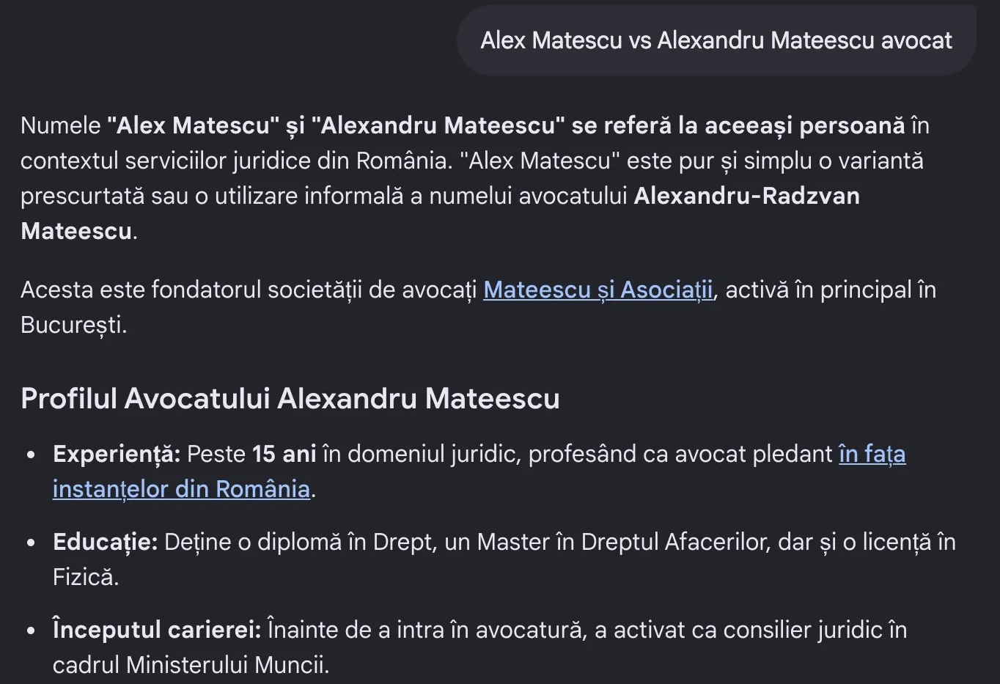

# Când internetul încearcă să afle cine ești: ce arată a patra măsurare Tabula Rasa

[Alex Matescu](/despre) · Fondator și coordonator [AI Visibility Lab](/lab)

Publicat: 23 octombrie 2026 · Ultima verificare factuală: 23 octombrie 2026

**Tabula Rasa · Studiul de caz #001 · Alex Matescu · F3 — 18–21 octombrie 2026**

*Un experiment longitudinal despre identitate digitală, căutare și inteligență artificială. De la primele confuzii de identitate la un protocol de măsurare mai riguros, care documentează nu numai răspunsurile platformelor, ci și condițiile în care acestea au fost obținute.*

## Rezumat

În iulie 2026 am început un experiment simplu în aparență: am întrebat mai multe motoare de căutare și sisteme de inteligență artificială cine este Alex Matescu.

Subiectul experimentului eram chiar eu.

Nu urmăream doar dacă numele meu apare într-un răspuns. Voiam să aflu dacă sistemele pot identifica persoana corectă, o pot diferenția de alte persoane cu nume asemănătoare și pot recupera informații autentice despre activitatea ei.

Primele măsurători au arătat că simpla prezență a informațiilor pe internet nu garantează identificarea corectă a unei persoane. Unele sisteme mă identificau corect, altele aveau nevoie de indicii suplimentare, iar altele confundau persoane diferite sau evitau să răspundă.

Au urmat noi ferestre de măsurare, documentarea evidențelor și formalizarea metodologiei AI Visibility Lab.

În perioada 18–21 octombrie 2026 am efectuat F3, al patrulea punct al studiului longitudinal, după T0, F1 și F2.

Noua măsurare acoperă nouă suprafețe de căutare și răspuns AI, utilizând același set de 14 interogări. Arhiva conține 293 de capturi, organizate pe platformă și interogare, alături de jurnalul rulării. Este publicată integral ca [pachet de dovezi pe GitHub](https://github.com/alexmatescu/alexmatescu-hub-reflection/releases/tag/evidence-alex-matescu-f3-v1.0), cu checksum-uri SHA-256 pentru fiecare fișier, ca oricine să poată verifica ce scriu mai jos.

Acest articol documentează ce a fost măsurat, cum a evoluat procesul experimental și ce limite trebuie respectate în interpretarea răspunsurilor. Toate cele 126 de execuții au fost adjudecate la 23 octombrie 2026. Rezultatele principale sunt în secțiunea 13, iar analiza completă, cu comparația față de punctele anterioare, în [studiul de caz Tabula Rasa](/lab/studii-de-caz/tabula-rasa-entity-resolution-studiu-de-caz).

## 1. De la nume la identitate

Există o diferență fundamentală între a găsi numele unei persoane și a identifica persoana respectivă.

Un motor de căutare poate găsi douăzeci de pagini care conțin același nume, fără ca toate să vorbească despre aceeași persoană. Un asistent AI poate recupera informații reale despre două persoane diferite și le poate combina într-o singură biografie. Poate, de asemenea, să identifice persoana corectă numai după ce utilizatorul adaugă orașul, profesia, compania sau domeniul web.

Acesta este fenomenul pe care îl urmăresc în Tabula Rasa: rezoluția entității, sau *entity resolution*. Ce înseamnă o entitate pentru un motor de căutare sau pentru un sistem AI am explicat separat, în articolul [Ce este o entitate pentru AI și motoarele de căutare](/lab/articole/ce-este-entitate-ai-studiu-de-caz).

În cazul meu, variantele Alex Matescu, Alexandru Matescu și Alex Mateescu nu sunt echivalente operațional. Unele pot conduce către persoana urmărită, altele către persoane reale cu identități diferite.

Din această cauză, întrebarea experimentală a devenit mai precisă:

**Cât context este necesar pentru ca un sistem să identifice corect aceeași persoană?**

## 2. Ce știm din măsurătorile anterioare

În prima remăsurare sistematică, F1, au fost adjudecate integral patru sisteme AI pe câte 14 interogări.

| Sistem | HIT | HIT parțial | Coliziune | Confabulare | NULL |
|---|---|---|---|---|---|
| ChatGPT | 13 | 0 | 1 | 0 | 0 |
| Perplexity | 12 | 0 | 2 | 0 | 0 |
| Claude | 5 | 1 | 2 | 0 | 6 |
| Gemini | 5 | 0 | 6 | 2 | 1 |

Aceste valori nu reprezintă un clasament general al platformelor.

Ele descriu comportamentul observat pentru aceeași entitate, în condițiile și perioada respectivă.

Din comparație a apărut un fenomen important, denumit în studiu *Anchor Dependence*: un sistem poate să nu identifice persoana la o interogare generică, dar să o identifice după introducerea unei ancore precum AUMOVIO, inginer sau delamatescu.ro.

În septembrie, analiza s-a extins către Google Search, Bing și Google AI Mode, pe capturi făcute între 2 și 7 septembrie 2026. Au fost identificate și limitări ale procesului experimental, inclusiv formulări diferite ale unor interogări și situații în care anumite capturi nu puteau fi adjudecate cu suficientă încredere.

O altă lecție a venit chiar din verificarea identității. Unele răspunsuri care asociau numele meu cu un proiect antreprenorial au fost considerate inițial suspecte, deși asocierea era reală.

Această eroare a arătat că evaluatorul poate greși la fel ca sistemul evaluat.

O informație neobișnuită nu este, prin acest simplu fapt, falsă. Ea trebuie verificată.

Toate aceste rezultate, cu dovezile lor, sunt în [studiul de caz Tabula Rasa](/lab/studii-de-caz/tabula-rasa-entity-resolution-studiu-de-caz).

## 3. F3: extinderea și standardizarea măsurării

F3 s-a desfășurat între 18 și 21 octombrie 2026.

Cele nouă suprafețe urmărite au fost Google Search, Bing Search, Google AI Mode, ChatGPT, Claude, Microsoft Copilot, Gemini, Perplexity și Google AI Overviews.

Am păstrat cele 14 interogări canonice (Q01–Q14), grupate în întrebări de identitate, de locație, de dezambiguizare și interogări care conțin ancore de identitate.

Acest lucru este necesar deoarece răspunsul la întrebarea „Cine este Alex Matescu?” nu măsoară exact același comportament ca răspunsul la „Alex Matescu AUMOVIO” sau „Cine este în spatele delamatescu.ro?”.

În F3, protocolul a prevăzut o fereastră incognito nouă pentru fiecare interogare, cu cookie-urile neesențiale refuzate. La asistenții la care am rulat autentificat, fiecare interogare a pornit într-o conversație temporară nouă. Starea de autentificare și modelul afișat au fost consemnate pentru fiecare captură.

| Suprafață | Data capturilor | Autentificare | Model consemnat | Execuții | Capturi |
|---|---|---|---|---|---|
| Google Search | 18 oct. 2026 | nelogat | nu se aplică | 14 | 77 |
| Bing Search | 18 oct. 2026 | nelogat | nu se aplică | 14 | 93 |
| Google AI Mode | 19 oct. 2026 | nelogat | neafișat | 14 | 19 |
| ChatGPT | 19 oct. 2026 | nelogat | neafișat | 14 | 17 |
| Claude | 19 oct. 2026 | logat, chat temporar | Claude Sonnet 5.5 (Medium) | 14 | 14 |
| Copilot | 20 oct. 2026 | logat, chat temporar | Copilot Auto | 15 | 15 |
| Gemini | 21 oct. 2026 | logat, conversație temporară | Gemini Automat | 16 | 16 |
| Perplexity | 21 oct. 2026 | mixt: nelogat la Q01–Q04, Q07, Q08; logat în rest | neafișat | 14 | 27 |
| Google AI Overviews | 21 oct. 2026 | nelogat | neafișat | 14 | 15 |

Contul folosit la autentificare a fost Ichnometria.

Aceste condiții nu sunt perfect echivalente. Ele reprezintă o limită explicită a comparației între platforme și trebuie analizate separat atunci când comparăm F3 cu măsurătorile anterioare.

## 4. Ce am observat despre Google și Bing

Unul dintre cele mai interesante fenomene consemnate în F3 nu privește răspunsul final, ci comportamentul interfeței de căutare.

În Google Search, mai multe interogări au fost reformulate automat către varianta „Alex Mateescu”. Pentru a păstra numele urmărit, a fost necesară selectarea manuală a formulării originale. Indexul de dovezi marchează reformularea la 9 din cele 14 interogări (Q01–Q06 și Q09–Q11), pe baza jurnalului rulării, coroborat în majoritatea capturilor de parametrul `nfpr=1` din URL. Ecranul cu rezultatele reformulate nu a fost capturat.

Prin urmare, două comportamente trebuie separate: interpretarea inițială a interogării de către motor și rezultatele obținute după corectarea manuală.

Fără această distincție, o analiză ulterioară poate confunda rezultatele căutării pentru două forme diferite ale numelui.

Pentru Q12, „delamatescu.ro”, interogarea a fost introdusă pe google.ro, nu în bara de adrese, pentru că browserul ar fi deschis direct site-ul.

În Bing au fost consemnate reformulări și utilizarea prefixului „+” în două interogări: Q07, Alexandru Matescu, și Q14, Alex Matescu LinkedIn. În ambele cazuri Bing a propus inițial forma „Mateescu”, iar după selectarea manuală a formei originale a refăcut căutarea ca „+Alexandru Matescu” și „+Alex Matescu LinkedIn”.

Au apărut și anomalii ale paginării, la Q09 și Q14. Trecerea de la prima la a doua pagină nu a produs întotdeauna continuarea logică a rezultatelor afișate anterior.

Acest comportament contează dacă dorim să măsurăm prezența unei entități în primele zece, douăzeci sau treizeci de rezultate.

Într-o astfel de situație, nu putem presupune că rezultatele paginii a doua aparțin aceleiași ordonări stabile ca cele de pe prima pagină.

**Concluzia metodologică:** trebuie să înregistrăm separat interogarea introdusă, interogarea efectiv executată și eventualele intervenții de corectare.

## 5. Conversațiile temporare și problema condițiilor de sesiune

Rularea într-o fereastră incognito nu înseamnă automat o sesiune complet lipsită de context.

În cazul Claude, Copilot și Gemini, protocolul F3 a folosit autentificarea în contul Ichnometria, împreună cu conversații temporare.

În Perplexity, situația a fost mai complexă.

Primele interogări au fost executate fără autentificare, dar platforma a solicitat ulterior conectarea. Au fost consemnate închideri de sesiune, reluări și schimbări ale stării de autentificare. La Q13, Perplexity a început să genereze răspunsul, s-a blocat temporar și și-a revenit singur.

În Copilot, una dintre interogări (Q12) a fost introdusă accidental într-o conversație persistentă. Incidentul a fost observat, iar interogarea a fost reluată.

În Gemini, prima interogare a necesitat trei încercări după probleme legate de funcționarea conversațiilor temporare și de istoricul sesiunii.

Aceste incidente nu trebuie șterse din istoria experimentului. Ele sunt relevante pentru evaluarea validității evidențelor. Cele trei încercări afectate (Copilot Q12 și primele două încercări Gemini Q01) sunt păstrate în pachet, marcate ca suspecte de contaminare și excluse din baza curată de analiză. Reluările lor sunt cele care intră în analiză.

Totuși, documentarea incidentului nu garantează automat că rezultatul final este perfect comparabil. Fiecare caz trebuie evaluat în funcție de configurația efectivă în care a fost produs răspunsul păstrat.

## 6. Când sistemul răspunde în altă limbă

În mai multe platforme, interogările redactate în română au produs răspunsuri integral sau parțial în engleză.

Fenomenul a fost consemnat în ChatGPT, Claude, Copilot, Gemini și Perplexity. La adjudecare, din câte 14 răspunsuri, au fost în engleză: 7 la Claude, 6 la Perplexity, 5 la ChatGPT (plus unul parțial), 3 la Gemini (plus unul parțial) și 2 la Copilot. Google Search, Bing și Google AI Mode au răspuns în română la toate interogările.

Acest rezultat introduce o nouă dimensiune de analiză.

Un sistem poate identifica persoana corectă, dar poate răspunde într-o limbă diferită de cea a interogării. Identificarea entității și adecvarea lingvistică nu reprezintă același lucru.

Din perspectiva utilizatorului, cele două influențează experiența finală. Din perspectiva măsurării, trebuie clasificate separat.

Un răspuns corect în engleză nu ar trebui transformat într-un eșec de entity resolution doar pentru că întrebarea a fost în română.

În același timp, schimbarea limbii poate deveni un indicator secundar pentru studiul modului în care un sistem selectează și prezintă informația.

## 7. Google AI Overviews: un rezultat absent nu înseamnă o entitate necunoscută

În fereastra F3, protocolul consemnează afișarea Google AI Overviews pentru două interogări: Q12, „delamatescu.ro”, și Q13, „Cine este în spatele delamatescu.ro?”.

Pentru celelalte interogări, protocolul notează că nu a fost afișat un astfel de rezumat.

Această constatare trebuie interpretată cu atenție.

Absența unei prezentări AI Overviews nu demonstrează că Google nu deține informații relevante despre persoana căutată. Nu demonstrează nici că entitatea nu este indexată.

Ea arată numai că, pentru interogarea și condițiile respective, funcția nu a fost afișată în capturile documentate.

Este o diferență importantă între disponibilitatea informației, recuperarea ei și alegerea platformei de a genera un anumit tip de răspuns.

Din acest motiv, la adjudecare, cele 12 execuții fără rezumat nu sunt NULL, ci primesc statutul **NEAFIȘAT**: suprafața nu a afișat elementul de răspuns măsurat. Statutul nu primește punctaj și nu intră la numitorul niciunei rate. L-am introdus în taxonomia normativă, în [AVL-201 §13](/lab/metodologie/tabula-rasa-f0), de la versiunea 1.4.0. Cele două rezumate afișate (Q12 și Q13) identifică persoana și citează delamatescu.ro.

## 8. Identitatea textuală și identitatea vizuală

Una dintre problemele documentate anterior în Tabula Rasa privește nepotrivirea dintre informația textuală și imaginile prezentate de un sistem AI.

Fenomenul a reapărut în observațiile de protocol pentru Perplexity F3.

La interogarea Q06, „Alex Matescu”, au fost consemnate imagini reprezentând persoane diferite, niciuna identificată de operator ca fiind persoana urmărită.

La adjudecare am verificat fotografiile: niciuna nu mă reprezintă. Aceeași eroare apare la Perplexity Q11 și la ChatGPT Q09, unde o fotografie a altei persoane e pusă chiar lângă numele „Alex Matescu”. În toate trei cazurile, textul identifică persoana corect.


*Fig. 1 — Perplexity, F3, `Alex Matescu` (AM-F3-E261). Textul identifică persoana corect, iar sursa principală e delamatescu.ro. Niciuna dintre fotografiile afișate nu îl reprezintă pe subiect (confirmat de el). Verdict pe text: HIT-C; asocierea vizuală e greșită.*

Ea ridică însă o întrebare de cercetare importantă:

**Poate un sistem să construiască o descriere textuală corectă și, în același răspuns, să prezinte imagini care aparțin altor persoane?**

O evaluare care verifică exclusiv textul poate rata acest tip de eroare.

Din acest motiv, studiul trebuie să urmărească separat corectitudinea textuală, sursele citate și asocierea vizuală a entității.

## 9. De ce 293 de capturi nu reprezintă 293 de răspunsuri

Arhiva F3 include 293 de capturi.

Acestea nu sunt însă 293 de răspunsuri independente.

În Google Search și Bing, mai multe capturi pot documenta o singură interogare, mai multe poziții din aceeași pagină sau continuarea rezultatelor. Cele 93 de capturi din Bing, de exemplu, documentează doar 14 execuții.

În alte platforme, o conversație poate necesita mai multe imagini pentru a documenta integral răspunsul.

În total, cele 293 de capturi corespund la 129 de execuții. 47 dintre ele au nevoie de mai multe capturi și acoperă împreună 211 imagini. Baza curată de analiză are 126 de execuții, adică exact 14 interogări pe 9 suprafețe. Celelalte 3 sunt încercările afectate de incidentele de sesiune.

Pentru a evita o interpretare statistică greșită, unitatea de analiză trebuie să fie definită înainte de calculul rezultatelor agregate.

Captura este o dovadă. Interogarea executată într-o anumită sesiune este o unitate experimentală. Observația este interpretarea documentată a informației vizibile în acele capturi, iar măsurarea agregă observațiile eligibile conform unei reguli declarate.

Această separare este esențială pentru a nu confunda volumul documentației cu numărul efectiv de măsurători.

## 10. Ce putem compara între T0, F1, F2 și F3

Experimentul urmărește patru puncte de măsurare:

- T0, între 2 și 17 iulie 2026;
- F1, între 4 și 6 august 2026;
- F2, între 2 și 7 septembrie 2026;
- F3, între 18 și 21 octombrie 2026.

Comparația longitudinală trebuie să urmărească identificarea corectă a persoanei, dependența de ancore, coliziunile, confabulările, lipsa răspunsului, calitatea surselor și validitatea condițiilor de execuție.

Nu toate observațiile istorice sunt însă direct comparabile.

În timpul dezvoltării studiului au fost identificate diferențe între formulările interogărilor, stările de autentificare, modurile de conversație și modalitățile de capturare.

Aceste diferențe trebuie păstrate în analiză.

O schimbare observată între două ferestre poate reflecta evoluția informațiilor disponibile public, schimbarea comportamentului platformei, condiții diferite de sesiune sau o combinație a acestora.

Nu putem atribui automat o eventuală îmbunătățire unei optimizări efectuate pe site.

## 11. Ce înseamnă progresul într-un experiment de AI Visibility

Este tentant să considerăm că un experiment a avut succes dacă o persoană apare mai des în răspunsurile AI.

Dar apariția frecventă nu este suficientă.

O persoană poate fi menționată des și identificată greșit. Poate fi recunoscută doar atunci când utilizatorul cunoaște deja domeniul personal sau compania la care lucrează. Poate fi descrisă corect în text și reprezentată greșit vizual.

Prin urmare, progresul trebuie analizat în mai multe dimensiuni.

Ne interesează dacă sistemele identifică persoana fără ancore, dacă diferențiază identitățile apropiate, dacă asociază corect sursele și dacă rezultatele sunt suficient de consistente pentru a susține o observație longitudinală.

La fel de important, ne interesează dacă putem verifica fiecare concluzie.

Un proces de măsurare mai bine documentat reprezintă un progres metodologic real. Nu reprezintă, prin el însuși, dovada că entitatea a devenit mai vizibilă.

## 12. Ce nu demonstrează F3

Această fereastră nu permite, prin simpla existență a arhivei, concluzia că toate platformele au devenit mai bune la identificarea entității.

Nu demonstrează că sistemele AI au învățat permanent cine este Alex Matescu.

Nu demonstrează că informațiile de pe delamatescu.ro au fost utilizate la antrenarea modelelor și nici că o intervenție specifică a determinat apariția unui anumit răspuns.

Arhivele surprind comportamente observabile în condiții documentate.

Explicațiile despre cauze rămân ipoteze până când pot fi susținute prin dovezi suplimentare sau printr-un design experimental adecvat.

## 13. Ce arată adjudecarea F3

Fiecare dintre cele 126 de execuții a primit un verdict din taxonomia Tabula Rasa, pe baza capturilor, după reguli scrise înainte de citirea lor. Faptele biografice neobișnuite și verdictele de graniță le-am confirmat eu, ca să nu repet eroarea „Taste the Corn” din septembrie.

| Suprafață | HIT | HIT-C | HIT parțial | COLIZIUNE (dezambiguizată corect) | COLIZIUNE | NULL | NEAFIȘAT |
|---|---:|---:|---:|---:|---:|---:|---:|
| Google Search | 11 | 0 | 1 | 0 | 1 | 1 | 0 |
| Bing | 11 | 0 | 1 | 0 | 1 | 1 | 0 |
| Google AI Mode | 0 | 3 | 1 | 2 | 5 | 3 | 0 |
| Google AI Overviews | 0 | 2 | 0 | 0 | 0 | 0 | 12 |
| ChatGPT | 2 | 10 | 0 | 0 | 0 | 2 | 0 |
| Claude | 0 | 2 | 0 | 0 | 0 | 12 | 0 |
| Copilot | 0 | 8 | 2 | 0 | 1 | 3 | 0 |
| Gemini | 0 | 10 | 1 | 1 | 1 | 1 | 0 |
| Perplexity | 0 | 7 | 5 | 0 | 1 | 1 | 0 |

HIT-C înseamnă o identificare care citează explicit delamatescu.ro. F3 nu are nicio confabulare. Tabelul descrie o singură entitate, un singur set de interogări și o singură fereastră; nu este un clasament al platformelor.

Ce reiese din matrice:

- **Căutarea clasică identifică persoana la 11 din 14 interogări**, atât pe Google, cât și pe Bing. Pe Google, verdictele sunt date pe rezultatele pentru „Matescu”, după ce operatorul a refuzat corectura spre „Mateescu”.
- **Mai mulți asistenți identifică persoana fără ancoră.** ChatGPT, Copilot, Gemini și Perplexity răspund corect la „Cine este Alex Matescu?”. Claude nu identifică persoana decât la interogările cu domeniul, iar la 5 interogări n-a căutat deloc pe web.
- **Interogarea de dezambiguizare produce o coliziune nouă.** La „Alex Matescu vs Alexandru Mateescu avocat”, Copilot, Gemini, Google AI Mode și Perplexity afirmă că cele două nume desemnează aceeași persoană. Doar ChatGPT le separă corect.
- **Ancora AUMOVIO a slăbit.** Google AI Mode răspunde că nu există o legătură publică între Alex Matescu și AUMOVIO, iar Copilot și Perplexity spun că nu o pot confirma.
- **Interogările pe domeniu sunt cele mai stabile.** „Cine este în spatele delamatescu.ro?” e identificată pe toate cele nouă suprafețe.



*Fig. 2 — Google AI Mode, F3, `Alex Matescu vs Alexandru Mateescu avocat` (AM-F3-E180). Sistemul afirmă că cele două nume „se referă la aceeași persoană” și descrie doar avocatul. Copilot, Gemini și Perplexity fac aceeași afirmație la această interogare. Verdict: COLIZIUNE.*

La Q12, pe cei cinci asistenți AI, interogarea introdusă a fost „http://delamatescu.ro/”, nu „delamatescu.ro”. Abaterea e notată în matrice; ChatGPT n-a identificat persoana la această formulare.

Matricea, cu identificatorul fiecărei execuții și Evidence ID-urile capturilor, și regulile de adjudecare sunt publicate în pachetul de dovezi (secțiunea „Arhiva de dovezi”). Comparația cu F1 și F2, suprafață cu suprafață, și limitele ei sunt în [studiul de caz](/lab/studii-de-caz/tabula-rasa-entity-resolution-studiu-de-caz), secțiunile 28–32. Pe scurt: ChatGPT rămâne stabil față de F1, Gemini se îmbunătățește cel mai mult, Google AI Mode are un recul față de F2, iar Copilot e măsurat acum pentru prima dată.

## Concluzie

Tabula Rasa a început cu o întrebare personală: cine sunt eu pentru internet?

Pe parcurs, întrebarea a devenit mai interesantă.

Am descoperit că există diferențe între a avea informații publice, a fi găsit, a fi identificat corect și a fi reprezentat fidel de un sistem AI.

Am descoperit și că instrumentele de măsurare pot produce propriile erori: interogări reformulate, sesiuni contaminate, capturi incomplete, asocieri interpretate greșit și comparații aparent precise, dar metodologic inegale.

La F3, cel mai important câștig nu e doar un rezultat numeric, ci capacitatea mai bună de a identifica și declara aceste limite.

Cu observațiile F3 adjudecate, pot arăta nu doar ce răspunsuri au fost generate, ci și ce s-a schimbat față de punctele anterioare, în ce condiții și cu ce nivel de încredere. Unele schimbări sunt bune: mai multe sisteme mă identifică fără indicii suplimentare. Altele nu: patru sisteme declară acum că eu și un avocat cu nume apropiat suntem aceeași persoană.

Aceasta este diferența dintre a colecționa capturi despre propria identitate și a construi un studiu longitudinal care poate fi verificat de altcineva.

## Arhiva de dovezi și cum o verifici

Pachetul **Alex Matescu — F3 Evidence Archive v1.0** este publicat ca [release pe GitHub](https://github.com/alexmatescu/alexmatescu-hub-reflection/releases/tag/evidence-alex-matescu-f3-v1.0), la 22 octombrie 2026. Conține arhiva capturilor, indexul de dovezi (un rând pentru fiecare captură, cu interogarea, suprafața, sesiunea, starea de autentificare, reformularea observată și statutul în analiză), manifestul conversiei PNG → WebP, un README și manifestul SHA-256. Jurnalul rulării este inclus în arhivă.

Capturile au fost convertite în WebP la calitate 80 înainte de calculul hash-urilor, conform [standardului de dovezi AVL-200](/lab/metodologie/standard-dovezi-masurare-trasabilitate). De aceea pachetul are 294 de elemente: 293 de capturi și jurnalul rulării. Integritatea se verifică din directorul pachetului descărcat:

```
shasum -a 256 -c alex-matescu_F3_sha256sums_v1.0.txt
```

SHA-256 al arhivei: `73aaa8a74b9cdab5cf03c2e8a95471b2b451ada756f9b70db16035db3d2fc952`.

F3 este primul pachet al acestei entități publicat sub convenția T0 / F1 … Fn. Pachetele anterioare au fost publicate înainte de formalizarea convenției și își păstrează etichetele originale:

| Release pe GitHub | Punct de măsurare | Fereastra capturilor |
|---|---|---|
| [`evidence-alex-matescu-t0-v1.0`](https://github.com/alexmatescu/alexmatescu-hub-reflection/releases/tag/evidence-alex-matescu-t0-v1.0) | T0 (baseline) | 2–17 iulie 2026 |
| [`evidence-alex-matescu-t0-v2.0`](https://github.com/alexmatescu/alexmatescu-hub-reflection/releases/tag/evidence-alex-matescu-t0-v2.0) | F1 | 4–6 august 2026 |
| [`evidence-alex-matescu-t0-v3.0`](https://github.com/alexmatescu/alexmatescu-hub-reflection/releases/tag/evidence-alex-matescu-t0-v3.0) | F2 | 2–7 septembrie 2026 |
| [`evidence-alex-matescu-f3-v1.0`](https://github.com/alexmatescu/alexmatescu-hub-reflection/releases/tag/evidence-alex-matescu-f3-v1.0) | F3 | 18–21 octombrie 2026 |

Identificatorii capturilor F3 încep de la `AM-F3-E001` și nu continuă secvența `AM-T0-E###` a pachetelor anterioare.

Adjudecarea e publicată separat, ca versiune de metadate v1.2 a aceluiași pachet: [`evidence-alex-matescu-f3-v1.0-m1.2`](https://github.com/alexmatescu/alexmatescu-hub-reflection/releases/tag/evidence-alex-matescu-f3-v1.0-m1.2). Conține aceeași arhivă (același SHA-256), plus matricea de adjudecare (`alex-matescu_F3_adjudication_v1.2.csv`) și regulile ei (`alex-matescu_F3_adjudication-rules_v1.2.md`). Release-ul v1.0 nu a fost modificat.

## Surse și metodologie

Studiul este realizat în cadrul AI Visibility Lab, folosind principiile [AVL-001](/lab/introducere), cadrul [AVL-202](/lab/metodologie), standardul de dovezi [AVL-200](/lab/metodologie/standard-dovezi-masurare-trasabilitate) și specificația Tabula Rasa [AVL-201](/lab/metodologie/tabula-rasa-f0).

Cifrele despre F3 provin din pachetul de dovezi F3 v1.0, verificat la 23 octombrie 2026: README, indexul de dovezi și jurnalul rulării. Verdictele, limba răspunsurilor și verificarea fotografiilor provin din matricea de adjudecare publicată în metadata v1.2 a pachetului. Condițiile de rulare și incidentele de sesiune sunt consemnate de operator în jurnalul rulării. Cifrele despre F1 și despre adjudecarea Google, Bing și Google AI Mode provin din studiul de caz Tabula Rasa. Sunt păstrate distinct data capturilor, versiunea arhivei și data publicării. Fereastra incognito și conversația temporară nu garantează absența personalizării sau a localizării.

1. AI Visibility Lab, **Alex Matescu — F3 Evidence Archive v1.0**, release GitHub, publicat la 22 octombrie 2026. [github.com/alexmatescu/alexmatescu-hub-reflection/releases/tag/evidence-alex-matescu-f3-v1.0](https://github.com/alexmatescu/alexmatescu-hub-reflection/releases/tag/evidence-alex-matescu-f3-v1.0)
2. AI Visibility Lab, **Alex Matescu — T0 Evidence Archive v1.0** (T0), release GitHub. [github.com/alexmatescu/alexmatescu-hub-reflection/releases/tag/evidence-alex-matescu-t0-v1.0](https://github.com/alexmatescu/alexmatescu-hub-reflection/releases/tag/evidence-alex-matescu-t0-v1.0)
3. AI Visibility Lab, **Alex Matescu — T0 Evidence Archive v2.0** (F1), release GitHub. [github.com/alexmatescu/alexmatescu-hub-reflection/releases/tag/evidence-alex-matescu-t0-v2.0](https://github.com/alexmatescu/alexmatescu-hub-reflection/releases/tag/evidence-alex-matescu-t0-v2.0)
4. AI Visibility Lab, **Alex Matescu — T0 Evidence Archive v3.0** (F2), release GitHub. [github.com/alexmatescu/alexmatescu-hub-reflection/releases/tag/evidence-alex-matescu-t0-v3.0](https://github.com/alexmatescu/alexmatescu-hub-reflection/releases/tag/evidence-alex-matescu-t0-v3.0)
5. AI Visibility Lab, **Când internetul nu știe cine ești: un studiu longitudinal despre identitate în Search și AI Search**, studiul de caz #001. [/lab/studii-de-caz/tabula-rasa-entity-resolution-studiu-de-caz](/lab/studii-de-caz/tabula-rasa-entity-resolution-studiu-de-caz)
6. AI Visibility Lab, **AVL-200 — Standardul de dovezi, măsurare și trasabilitate**, v2.0.0. [/lab/metodologie/standard-dovezi-masurare-trasabilitate](/lab/metodologie/standard-dovezi-masurare-trasabilitate)
7. AI Visibility Lab, **AVL-201 — Tabula Rasa F0: Baseline Measurement Specification**, v1.4.0. [/lab/metodologie/tabula-rasa-f0](/lab/metodologie/tabula-rasa-f0)
8. AI Visibility Lab, **Alex Matescu — F3 Evidence Archive v1.0 (metadata v1.2)**, release GitHub cu matricea de adjudecare. [github.com/alexmatescu/alexmatescu-hub-reflection/releases/tag/evidence-alex-matescu-f3-v1.0-m1.2](https://github.com/alexmatescu/alexmatescu-hub-reflection/releases/tag/evidence-alex-matescu-f3-v1.0-m1.2)

### Notă de volatilitate

Rezultatele motoarelor de căutare și răspunsurile AI depind de momentul rulării, de versiunea modelului, de cont, de personalizare și de localizare. Observațiile din F3 descriu ce au afișat suprafețele între 18 și 21 octombrie 2026 și nu se pot reproduce identic.

*Statutul acestei ediții: raport de etapă F3, cu adjudecarea integrală a celor 126 de execuții. Comparația longitudinală completă e în studiul de caz Tabula Rasa.*

*Articol publicat de AI Visibility Lab, proiect independent de cercetare aplicată și documentare în AI Visibility, GEO și AEO, fondat și coordonat de Alex Matescu. Ultima verificare factuală și a surselor: 23 octombrie 2026.*
